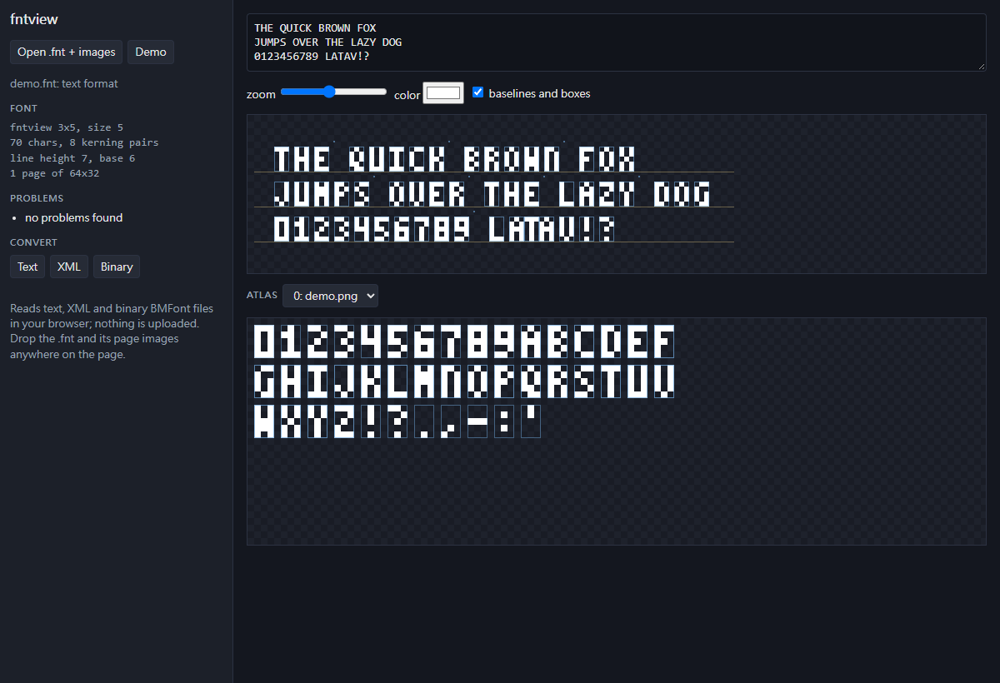

# fntview

[English](README.en.md)

在瀏覽器檢查 BMFont 點陣字型（.fnt）：預覽文字排版、看圖集裡每個字的範圍、找出會讓遊戲裡字壞掉的問題，也能在文字、XML、二進位三種格式之間互轉。檔案只在瀏覽器裡讀，不會上傳。

線上使用：https://vtxe02023274.github.io/fntview/



BMFont 是 AngelCode 的點陣字型格式，libGDX、Phaser、MonoGame、Cocos 等引擎都直接讀，很多字型產生工具也輸出這種格式。

## 功能

- 讀文字、XML、二進位（第 3 版）三種 .fnt，以及 msdf-bmfont 這類工具輸出的 JSON，自動判斷格式
- 照 BMFont 的規則排版：xoffset／yoffset、xadvance、字距調整（kerning）、換行用 lineHeight
- 支援距離場字型（SDF、PSDF、MSDF、MTSDF，讀 `distanceField` 設定）：預覽照 MSDF shader 的算法解碼，放大也不會糊；附一個 SDF 範例字型
- 顯示基線和每個字的框，方便看偏移對不對
- 圖集檢視：每個字的範圍，滑鼠移上去顯示 id、大小、偏移
- 檢查問題：字超出圖集、頁面編號不存在、重複的字、缺空白字元、kerning 指到不存在的字、圖片大小跟字型宣告不同
- 匯出成文字、XML、JSON 或二進位格式，也可以存出頁面圖片
- 從 .ttf／.otf／.woff 產生 BMFont：用瀏覽器的文字繪製點陣化、自動排進圖集、量出字距調整，字型裡沒有的字會略過並列出來，不用裝 BMFont 或 Hiero

## 用法

1. 按「Open .fnt + images」，把 .fnt 和它的頁面圖片一起選，或直接拖進頁面
2. 在上方輸入要預覽的文字

按「Demo」可以看內建的範例字型：`tools/make-demo.mjs` 畫的 3×5 像素字，沒有用到第三方字型。

## 開發

```sh
npm install
npm run build   # 輸出到 site/
npm test
npm run lint
```

`src/font.ts`（讀寫三種格式）、`src/layout.ts`（排版）、`src/check.ts`（檢查）都不依賴瀏覽器，可以在 Node 裡用。

## 授權

MIT
